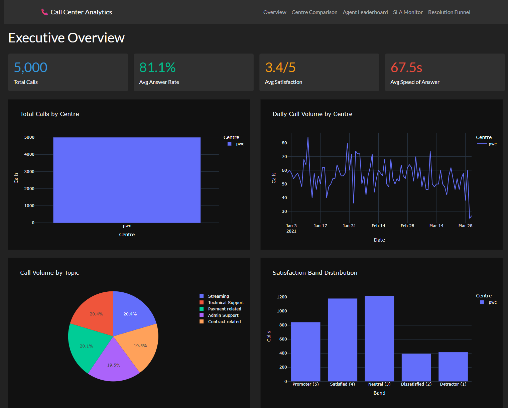
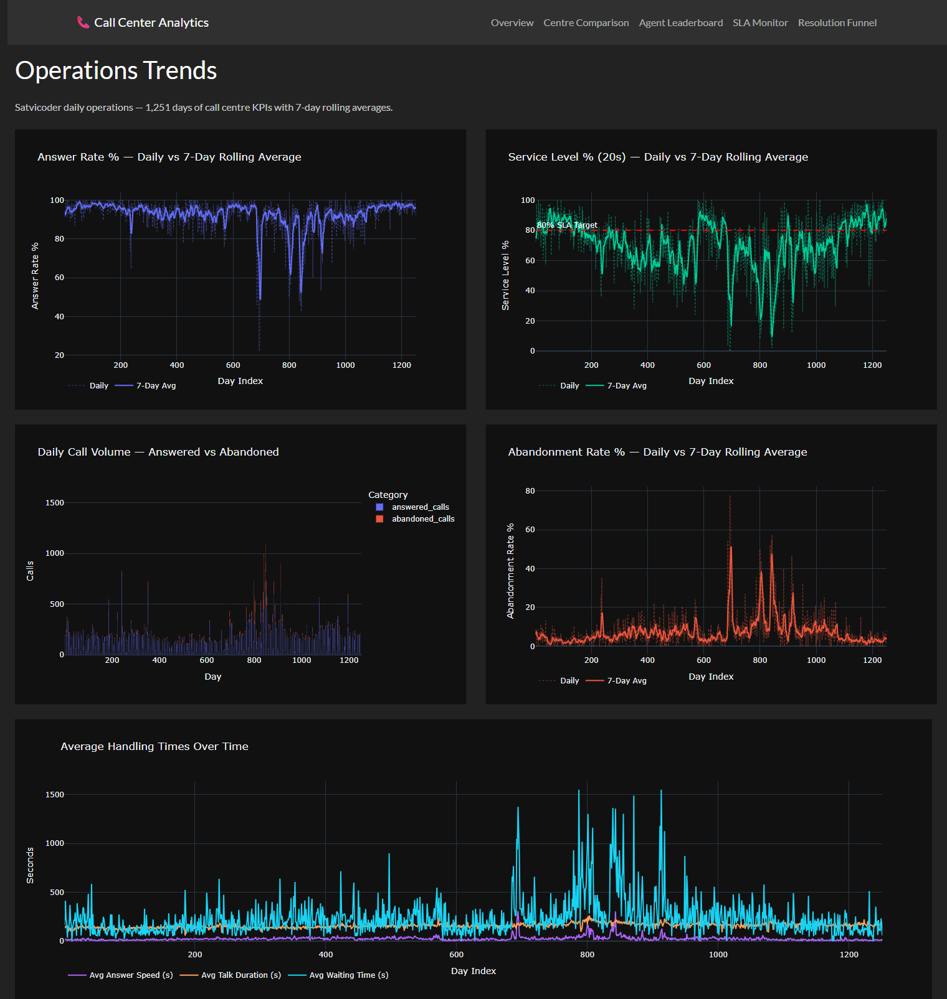
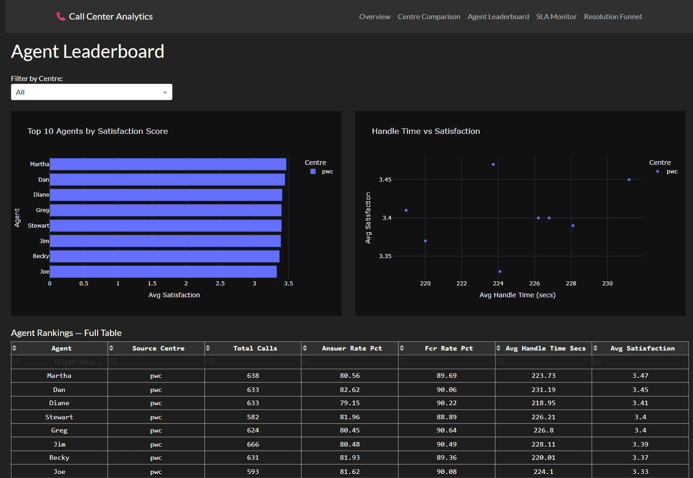
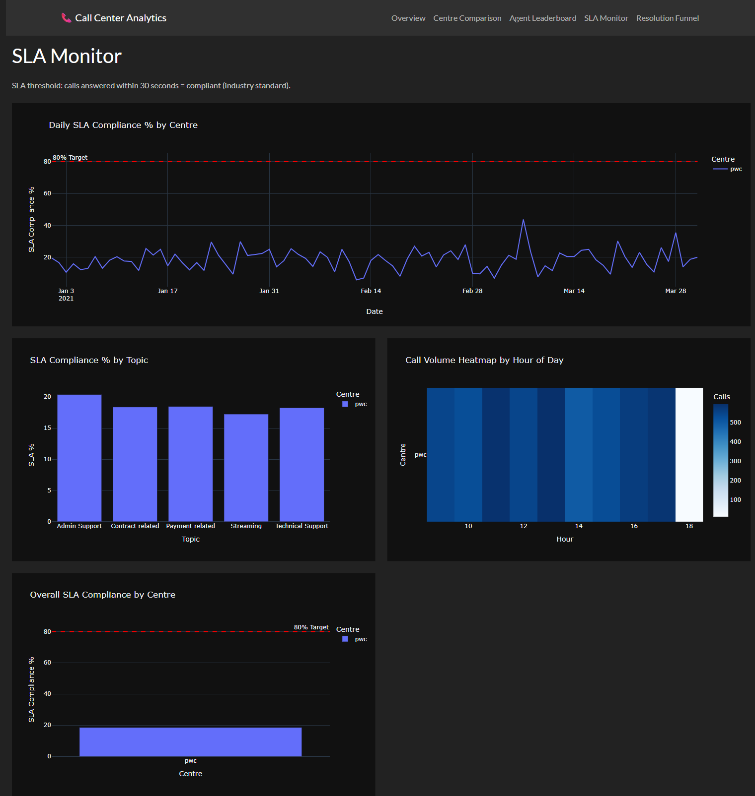
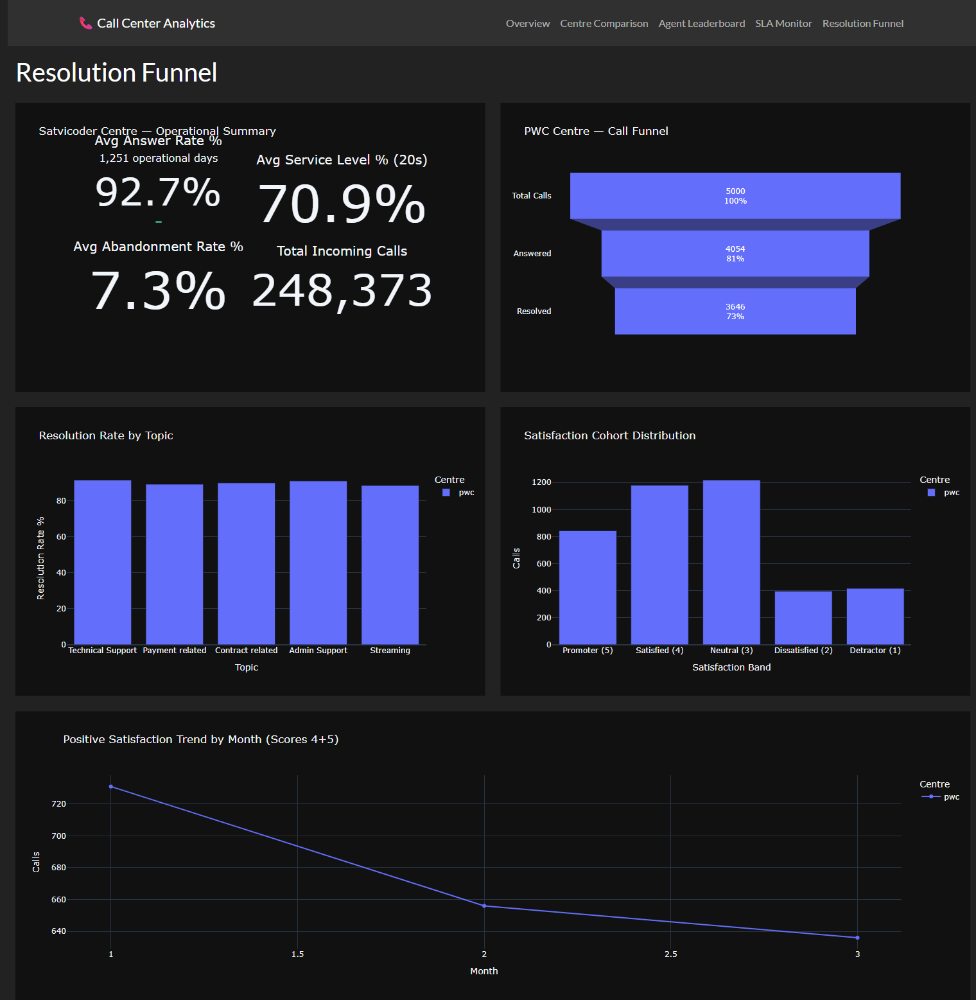

# 📞 Call Center Analytics: Dual-Source Call Centre Intelligence Pipeline

**Call Center Analytics** is a production-grade call centre intelligence pipeline that ingests 1,251 days of operational KPI aggregates from the Satvicoder Kaggle dataset and 5,000 individual call records from the PWC Kaggle dataset, downloads both at DAG runtime via the Kaggle REST API v1 bypassing the CLI's KGAT token incompatibility, transforms each dataset through its own dedicated dbt analytics path because their schemas are structurally incompatible, computes 7-day rolling averages on daily answer rate and service level data, derives per-agent FCR rates and SLA compliance across 5 call topics, stages CSAT ratings into promoter/satisfied/neutral/dissatisfied/detractor bands, and surfaces the complete analytical picture across a 5-page Plotly Dash dark-mode dashboard — the full analytical stack a contact centre operations manager or workforce planning team would use to monitor agent performance, SLA compliance, and daily operational trends.

| Metric | Value |
|--------|-------|
| Satvicoder daily KPI rows | 1,251 (operational day aggregates) |
| PWC individual call records | 5,000 (agent-level call logs) |
| Airflow tasks | 9 (2 download → 2 ingest → dbt deps/staging/intermediate/marts/test) |
| dbt models | 10 (2 staging · 2 intermediate · 6 marts) |
| dbt tests | 72 (all passing) |
| Dashboard pages | 5 |
| Cost to run | $0 — Kaggle free tier + local stack only |

---

## 🎯 Project Goal

Call centre operations teams across Africa and globally track two fundamentally different types of data — day-level operational KPIs (how many calls came in, how many were abandoned, what was the service level against the 20-second threshold) and agent-level call records (who handled what topic, was the issue resolved, what did the customer rate the interaction). Most analytics projects force these into a single table by fabricating missing columns, producing a dataset that's formally unified but analytically misleading — you can't derive satisfaction scores for an aggregate row, and you can't compute a service level from individual records that have no timestamp for when the call entered the queue.

Call Center Analytics treats these datasets honestly. The Satvicoder dataset (1,251 daily rows, no agent or satisfaction data) feeds operational trend analysis — answer rate over time, abandonment patterns, service level against the 80% industry benchmark — with 7-day rolling averages to smooth the noise inherent in daily aggregate data. The PWC dataset (5,000 individual records with agent, topic, resolution, and CSAT) feeds agent performance, SLA compliance, topic analysis, and satisfaction cohort analysis. Both datasets are downloaded at DAG runtime via the Kaggle REST API (bypassing the CLI which is incompatible with KGAT-format tokens), ingested into DuckDB under a single-writer Airflow pool, and transformed through dedicated dbt paths that produce six mart tables — each materialized exactly at the grain a dashboard page needs.

---

## 🧬 System Architecture

1. **Download — Kaggle REST API v1** — both datasets are fetched at DAG runtime via direct HTTP calls to `https://www.kaggle.com/api/v1/datasets/download/{owner}/{dataset}` using `requests.get` with HTTP Basic Auth (KAGGLE_USERNAME, KAGGLE_KEY); the response is a ZIP stream unzipped in-memory via `zipfile.ZipFile(io.BytesIO(content))`; this completely bypasses the kaggle CLI which raises `KeyError: 'username'` and `Protocol message DatasetInfo has no "info" field` when KGAT-format tokens are used with kaggle 1.7.4's internal protobuf layer; two download tasks run in parallel since they write to different local directories under `/opt/airflow/data/raw/`

2. **Ingestion — Satvicoder** — `ingest_satvicoder.py` locates the CSV under `/opt/airflow/data/raw/satvicoder/` via glob, reads it with `pd.read_csv()`, and writes to DuckDB `raw.raw_satvicoder_calls`; the dataset's 1,251 rows are daily operational aggregates with columns `Index`, `Incoming Calls`, `Answered Calls`, `Abandoned Calls`, `Answer Rate` (%), `Service Level (20 Seconds)` (%), `Answer Speed (AVG)` (HH:MM:SS), `Talk Duration (AVG)` (HH:MM:SS), `Waiting Time (AVG)` (HH:MM:SS) — there are no agent names, no call IDs, no individual timestamps, and no satisfaction ratings; any model that tries to join these to PWC records by calling pattern produces structural nonsense

3. **Ingestion — PWC** — `ingest_pwc.py` locates the XLSX under `/opt/airflow/data/raw/pwc/` and reads it with `pd.read_excel(engine='openpyxl')`; the 5,000 rows are individual call records with `Call Id`, `Agent`, `Date` (stored as ISO YYYY-MM-DD strings, not M/D/YYYY), `Time`, `Topic`, `Answered (Y/N)`, `Resolved`, `Speed of answer in seconds`, `AvgTalkDuration`, `Satisfaction rating`; 946 unanswered calls legitimately have NULL for speed, talk duration, and satisfaction — those are not data quality failures, they are calls that never reached an agent

4. **DuckDB write serialisation** — both ingestion tasks and all dbt tasks share an Airflow pool (`duckdb_pool`, 1 slot); DuckDB's file-level write lock means two tasks opening the same warehouse simultaneously will raise `IOException: Could not set lock on file`; the pool serialises all writes at the Airflow scheduling layer — no mutexes, no retry logic, no application-level locking; the Dash container connects with `read_only=True` and can issue queries concurrently with each other but is blocked during any write

5. **dbt staging — separate paths per schema** — `stg_satvicoder_daily` casts the daily aggregate columns: HH:MM:SS duration strings are converted to seconds via `EPOCH(CAST("Answer Speed (AVG)" AS TIME))`, percent columns use `REPLACE(CAST(col AS VARCHAR), '%', '')` to strip any `%` sign before casting to DOUBLE; `stg_pwc_calls` casts the individual call records: dates use `CAST("Date" AS DATE)` (not STRPTIME with `%m/%d/%Y` — the actual data format is ISO), Y/N flags become booleans via `UPPER(TRIM(...)) = 'Y'`, and `EPOCH(CAST("AvgTalkDuration" AS TIME))` converts HH:MM:SS to seconds; both models are materialised as views; the two schemas are never unioned because a daily aggregate row has no agent and no satisfaction score

6. **dbt intermediate** — `int_daily_operations` adds `abandonment_rate_pct` as `abandoned_calls / incoming_calls * 100` and `avg_handle_time_secs` as `avg_answer_speed_secs + avg_talk_duration_secs`; `int_call_records` adds `meets_sla_30s` (boolean, NULL for unanswered calls) and `total_handle_secs`; both views feed their respective mart chains

7. **dbt marts — six tables at query grain** — `mart_daily_operations` materialises daily KPIs with 7-day rolling averages for answer rate, service level, and abandonment rate using `AVG(...) OVER (ORDER BY day_index ROWS BETWEEN 6 PRECEDING AND CURRENT ROW)`; the five PWC marts aggregate at agent, date/hour/topic, topic, hour-of-day, and satisfaction-band grain; `mart_sla_compliance` uses `COALESCE(met/answered * 100, 0)` to return 0 rather than NULL for the 315 date/hour/topic buckets where no calls were answered

8. **Plotly Dash dashboard — 5 pages** — multi-page with `use_pages=True`; each page registers with `dash.register_page(__name__)`; every callback opens a `read_only=True` DuckDB connection via context manager, runs a single query, closes immediately; no shared connection state between callbacks; `host='0.0.0.0'` required for Docker port binding; all charts use the DARKLY Bootstrap theme

---

## 🛠️ Technical Stack

| **Layer** | **Tool** | **Version** |
|---|---|---|
| Orchestration | Apache Airflow (LocalExecutor, AIP-72) | 3.0 |
| OLAP database | DuckDB | 1.2.2 |
| Data transformation | dbt-duckdb | 1.9.2 |
| Dashboard | Plotly Dash | 2.18.2 |
| Dashboard theme | Dash Bootstrap Components (DARKLY) | — |
| Data source | Kaggle REST API v1 (HTTP Basic Auth) | — |
| XLSX parsing | openpyxl | 3.1.5 |
| Data wrangling | pandas | 2.1.4 |
| HTTP client | requests | 2.32.3 |
| Containerisation | Docker Compose (7 services) | — |
| Language | Python | 3.11 |

---

## 📊 Performance & Results

- **1,251 Satvicoder rows** loaded in under 2 seconds; **5,000 PWC rows** (XLSX) loaded in under 8 seconds — both downloaded at DAG runtime from Kaggle in under 2 seconds each via REST API
- **Full 9-task pipeline** (2 parallel downloads → serialised ingest → dbt deps/staging/intermediate/marts/test) completes in approximately **3 minutes** end-to-end
- **72 dbt schema tests** across 3 layers run in under 15 seconds — all 72/72 PASS
- **PWC call centre portfolio**: 5,000 total calls · 4,054 answered (81%) · 3,646 resolved (73%) · 3.4/5 average satisfaction · 67.5s average speed of answer
- **Satvicoder operational summary** across 1,251 days: 92.7% average answer rate · 70.9% average service level (20-second threshold) · 7.3% average abandonment rate · 248,373 total incoming calls
- **7-day rolling averages** computed in-database using window functions — smooth the visible daily noise in answer rate and service level trends across all 1,251 operational days
- **946 legitimately NULL records** in the PWC dataset (unanswered calls with no speed, talk duration, or satisfaction) — correctly handled by removing `not_null` constraints from those columns and using `CASE WHEN is_answered THEN ... END` in all mart aggregations rather than filtering them out

---

## 📸 Dashboard

### Airflow DAG — 9/9 Tasks SUCCESS, dbt 72/72 Tests Passing


*All 9 tasks completing successfully under `duckdb_pool` single-slot serialisation: 2 parallel Kaggle downloads → serialised ingest_satvicoder → ingest_pwc → dbt_deps → dbt_run_staging → dbt_run_intermediate → dbt_run_marts → dbt_test. The dbt_test log shows all 72 schema tests green.*

### Executive Overview



*KPI row: 5,000 total calls · 81.1% answer rate · 3.4/5 satisfaction · 67.5s speed of answer. Daily call volume time series (Jan–Mar 2021), topic distribution pie (5 topics, roughly equal split), and satisfaction band distribution (Promoter through Detractor). All data sourced from PWC mart tables.*

### Operations Trends (Satvicoder — 1,251 Days)



*Answer rate % and service level % each shown as raw daily value (dotted) against 7-day rolling average (solid line) — the rolling average makes the underlying trend visible through daily noise. Call volume stacked bar (answered vs abandoned), abandonment rate trend, and three-series handling time chart (answer speed, talk duration, waiting time) all spanning the full 1,251-day window.*

### Agent Leaderboard



*Top 10 agents by satisfaction score (horizontal bar), handle time vs satisfaction scatter plot, and full sortable/filterable data table showing all agents with total calls, answer rate %, FCR rate %, avg handle time, and avg satisfaction. Martha leads at 3.47 satisfaction, 80.56% answer rate, 89.69% FCR.*

### SLA Monitor



*Daily SLA compliance % over time with 80% industry target line (red dashed) — the PWC centre operates well below target at ~20%, indicating structural speed-of-answer issues rather than outlier days. SLA by topic (5 bars), hourly call volume heatmap (hours 9–18), and overall centre SLA summary.*

### Resolution Funnel



*Left: Satvicoder operational summary panel — 92.7% avg answer rate, 70.9% avg service level, 7.3% avg abandonment, 248,373 total incoming calls across 1,251 days. Right: PWC resolution funnel (5,000 → 4,054 answered → 3,646 resolved). Resolution rate by topic, CSAT cohort distribution, and monthly positive satisfaction trend (Jan–Mar 2021 showing decline from ~735 to ~640 promoters+satisfied per month).*

---

## 📑 Data Sources

| Dataset | Owner | Kaggle Slug | Format | Rows | Schema Type |
|---------|-------|-------------|--------|------|-------------|
| Call Center Data | satvicoder | `satvicoder/call-center-data` | CSV | 1,251 | Daily operational KPIs — no agent, no call ID, no satisfaction |
| PWC Call Centre Analysis | gayatriwagadre | `gayatriwagadre/pwc-call-centre-analysis` | XLSX | 5,000 | Individual call records — agent, topic, resolution, CSAT |

Both downloaded at DAG runtime via `GET https://www.kaggle.com/api/v1/datasets/download/{owner}/{dataset}` with HTTP Basic Auth using `KAGGLE_USERNAME` and `KAGGLE_KEY` environment variables. The ZIP response is unzipped in-memory without writing a zip file to disk.

---

## 🧠 Key Design Decisions

- **Separate dbt analytics paths rather than a forced UNION** — the Satvicoder dataset has no agent column, no call ID, no satisfaction rating, and no per-call timestamp — only daily aggregates. A UNION with the PWC call records would require fabricating those columns (setting agent = NULL, call_id = day_index, satisfaction = NULL) which produces a formally unified model that is analytically useless — mart_agent_performance would silently aggregate the 1,251 NULL-agent rows into an "unknown agent" bucket, and mart_satisfaction_cohorts would count 1,251 "Not Rated" rows that are actually operational summaries. Instead, `int_call_records` and `int_daily_operations` are two separate intermediate models feeding six separate mart tables — each dataset expresses its natural grain, and no columns are fabricated to make the schemas compatible.

- **Kaggle REST API v1 directly over the official CLI** — Kaggle's new KGAT-format tokens (`KGAT_...`) are incompatible with kaggle CLI 1.7.4's internal protobuf authentication layer. The CLI raises `KeyError: 'username'` when `build_kaggle_client()` reads the token, and `Protocol message DatasetInfo has no "info" field` when the token is forced through the protobuf schema — there is no stderr output and no indication of which step failed. The fix is to bypass the CLI entirely: a direct `requests.get(url, auth=(KAGGLE_USERNAME, KAGGLE_KEY), stream=True)` call to the v1 REST endpoint works with any token format including KGAT, returns the dataset as a ZIP stream, and lets us unzip in-memory with `zipfile.ZipFile(io.BytesIO(content))` without any subprocess or CLI dependency.

- **`CAST("Date" AS DATE)` instead of `STRPTIME` for PWC dates** — the PWC dataset stores dates as ISO 8601 strings (`2021-01-01`), not `M/D/YYYY` as originally assumed from Kaggle's column documentation. DuckDB's `STRPTIME(col, '%m/%d/%Y')` raises `Invalid Input Error: Could not parse string "2021-01-01"` because it tries to interpret `2021` as a month value. DuckDB's native `CAST(... AS DATE)` handles ISO 8601 strings natively with no format specifier required. This was caught only when marts materialised (which execute the view SQL) — the staging view creation step succeeds silently because DuckDB validates view definitions only at query time, not at `CREATE VIEW` time.

- **`COALESCE(sla_compliance_pct, 0)` to prevent NULL schema test failures** — `mart_sla_compliance` groups at date × hour × topic grain. Buckets where all calls in that group were unanswered produce `SUM(answered) = 0`; the `NULLIF(0, 0)` in the denominator returns NULL, which propagates to NULL for `sla_compliance_pct`. The 315 such rows caused the `not_null` schema test to fail. `COALESCE(..., 0)` returns 0% SLA compliance for zero-answer buckets, which is the semantically correct interpretation (no answered calls means 0% of calls met the SLA), and keeps the column non-null for dashboard rendering.

- **7-day rolling averages in `mart_daily_operations`** — raw daily operational KPIs in the Satvicoder dataset have high day-to-day variance that obscures trends when plotted as a time series. The window function `AVG(answer_rate_pct) OVER (ORDER BY day_index ROWS BETWEEN 6 PRECEDING AND CURRENT ROW)` computes the rolling average in-database at materialisation time rather than in Pandas at render time — the mart stores both the raw daily value and the 7-day average, and the dashboard chart plots both as separate traces (raw as dotted line, rolling average as solid) so both the noise and the signal are visible simultaneously.

- **`duckdb_pool` (1 slot) for write serialisation** — DuckDB supports only one writer per file at a time. Without the pool, `ingest_satvicoder` and `ingest_pwc` run in parallel after their respective download tasks complete, and both attempt to open the same DuckDB file for writing simultaneously. The second one to acquire the file lock raises `IOException: Could not set lock on file` and the task fails. The Airflow pool enforces sequential execution of all write-path tasks at the scheduling layer — no code-level locking, no retry logic — while the Dash container's `read_only=True` connections can issue queries freely in parallel.

- **`generate_schema_name` macro to prevent `main.main_staging` prefix** — dbt-duckdb's default schema resolution prepends the connection's database name to any custom schema name: `+schema: staging` resolves to `main_staging` in DuckDB's catalog, but dbt generates cross-references as `main.main_staging.stg_pwc_calls`. Mart models that ref staging views via `{{ ref('stg_pwc_calls') }}` work correctly because dbt resolves the ref internally, but any external query (tests, Airflow BashOperator calling dbt directly) that constructs schema-qualified names will fail to find the table. The macro overrides this to use the `custom_schema_name` as-is, ensuring schemas resolve identically inside and outside dbt's compilation context.

---

## 📂 Project Structure

```text
call-center-analytics/
├── Dockerfile.airflow                    # Airflow 3.0 image — pip install as USER airflow,
│                                         #   dbt-duckdb==1.9.2, openpyxl, requests, pandas
├── docker-compose.yml                    # 7 services: postgres, airflow-init, api-server,
│                                         #   scheduler, dag-processor, triggerer, dash
├── .env.example                          # KAGGLE_USERNAME, KAGGLE_KEY, AIRFLOW JWT secret,
│                                         #   DUCKDB_PATH, AIRFLOW_UID
├── requirements.txt                      # Local dev deps (pytest, duckdb, pandas, openpyxl)
├── dags/
│   └── call_center_dag.py               # 9-task DAG — REST API download, ingest, full dbt chain
├── ingestion/
│   ├── ingest_satvicoder.py             # CSV → raw.raw_satvicoder_calls (1,251 daily rows)
│   └── ingest_pwc.py                    # XLSX via openpyxl → raw.raw_pwc_calls (5,000 rows)
├── dbt/
│   ├── dbt_project.yml                  # staging=view, intermediate=view, marts=table
│   ├── profiles.yml                     # DuckDB path from DUCKDB_PATH env var, threads: 1
│   ├── macros/
│   │   └── generate_schema_name.sql     # Prevents main.main_staging prefix in dbt-duckdb
│   └── models/
│       ├── staging/
│       │   ├── sources.yml              # raw schema source declarations
│       │   ├── stg_satvicoder_daily.sql # HH:MM:SS → EPOCH(CAST AS TIME), % strip, 1,251 rows
│       │   ├── stg_pwc_calls.sql        # CAST DATE, Y/N → bool, 946 NULLs kept, 5,000 rows
│       │   └── schema.yml               # 26 tests — nullable cols documented, not forced not_null
│       ├── intermediate/
│       │   ├── int_daily_operations.sql # Derives abandonment_rate_pct, avg_handle_time_secs
│       │   ├── int_call_records.sql     # Adds meets_sla_30s (NULL for unanswered), total_handle_secs
│       │   └── schema.yml               # 13 tests — unique day_index, accepted_values on source_centre
│       └── marts/
│           ├── mart_daily_operations.sql     # 7-day rolling avgs — answer rate, SLA, abandonment
│           ├── mart_agent_performance.sql    # Per-agent: answer rate, FCR, handle time, CSAT
│           ├── mart_sla_compliance.sql       # Date×hour×topic grain — COALESCE sla_pct to 0
│           ├── mart_topic_analysis.sql       # Per-topic: volume, answer rate, resolution rate
│           ├── mart_hourly_patterns.sql      # Hour-of-day grain — volume, SLA, avg satisfaction
│           ├── mart_satisfaction_cohorts.sql # Band×topic×month — Promoter through Detractor
│           └── schema.yml                    # 33 tests — accepted_values on 6 satisfaction bands
├── dashboard/
│   ├── Dockerfile                        # Dash container — mounts duckdb-data volume read-only
│   ├── requirements.txt                  # dash, dash-bootstrap-components, plotly, duckdb
│   ├── app.py                            # Dash multi-page — use_pages=True, DARKLY theme, 0.0.0.0
│   └── pages/
│       ├── overview.py                   # KPI cards, daily volume line, topic pie, CSAT distribution
│       ├── comparison.py                 # Operations Trends — satvicoder 7-day rolling avg charts
│       ├── agent.py                      # Top-10 satisfaction bar, handle time scatter, full table
│       ├── sla.py                        # Daily SLA line (80% target), by-topic bar, hourly heatmap
│       └── resolution.py                 # Satvicoder summary indicators + PWC funnel + CSAT trend
├── tests/
│   ├── test_ingestion.py                # 9 pytest tests — row counts (1,251 + 5,000),
│   │                                    #   column presence, PWC satisfaction range, answered values
│   └── test_transformation.py          # 14 pytest tests — mart row counts, rate ranges (0–100),
│                                        #   valid hour range, rolling avg not-null, non-negative FCR
└── assets/
    ├── succesful dag runs.png           # Airflow UI — 9/9 tasks SUCCESS, dbt_test 72/72 PASS log
    ├── screenshot_overview.png
    ├── screenshot_ops_trends.png
    ├── screenshot_agent.png
    ├── screenshot_sla.png
    └── screenshot_resolution.png
```

---

## ⚙️ Installation & Setup

### Prerequisites

- Docker Desktop (Linux containers, 2 GB RAM minimum)
- Kaggle account — get your username from `kaggle.com/[username]` and generate an API token from **Settings → API → Create New Token**

### Steps

1. **Clone the repository**
   ```bash
   git clone https://github.com/declerke/Call-Center-Analytics.git
   cd Call-Center-Analytics
   ```

2. **Configure environment**
   ```bash
   cp .env.example .env
   # Edit .env and fill in:
   # KAGGLE_USERNAME=your-username
   # KAGGLE_KEY=your-api-key-or-kgat-token
   # AIRFLOW__API_AUTH__JWT_SECRET=$(python -c "import secrets; print(secrets.token_hex(16))")
   ```

3. **Build and start all services**
   ```bash
   docker compose up --build -d
   ```
   First build installs dbt-duckdb, openpyxl, requests, and all Airflow providers (~2–3 minutes).

4. **Wait for Airflow to initialise** (~2 minutes)
   ```bash
   docker compose logs -f airflow-scheduler
   # Wait until: "Scheduler started"
   ```

5. **Trigger the pipeline**
   ```bash
   docker compose exec airflow-scheduler airflow dags trigger call_center_pipeline
   ```
   Or use the Airflow UI at `http://localhost:8080` → DAGs → `call_center_pipeline` → Trigger. Full run completes in approximately 3 minutes.

6. **Access the stack**

   | Service | URL | Credentials |
   |---------|-----|-------------|
   | Plotly Dash dashboard | http://localhost:8050 | — |
   | Airflow UI | http://localhost:8080 | admin / Admin |

---

## 🗄️ dbt Models

| Model | Layer | Type | Rows | Description |
|-------|-------|------|------|-------------|
| `stg_satvicoder_daily` | Staging | View | 1,251 | Casts HH:MM:SS duration strings to seconds via `EPOCH(CAST AS TIME)`; strips `%` from percent columns; NULL-filtered on `Incoming Calls` |
| `stg_pwc_calls` | Staging | View | 5,000 | ISO date cast (`CAST("Date" AS DATE)`); Y/N → boolean; EPOCH for talk duration; 946 unanswered calls retain NULL for speed/duration/CSAT |
| `int_daily_operations` | Intermediate | View | 1,251 | Adds `abandonment_rate_pct` and `avg_handle_time_secs`; sources from `stg_satvicoder_daily` only |
| `int_call_records` | Intermediate | View | 5,000 | Adds `meets_sla_30s` (NULL for unanswered) and `total_handle_secs`; sources from `stg_pwc_calls` only |
| `mart_daily_operations` | Mart | Table | 1,251 | Daily KPIs + `answer_rate_7d_avg`, `service_level_7d_avg`, `abandonment_rate_7d_avg` via window functions |
| `mart_agent_performance` | Mart | Table | 8 | Per-agent totals, answer rate %, FCR rate %, avg handle time, avg satisfaction — NULL-safe via `CASE WHEN is_answered` |
| `mart_sla_compliance` | Mart | Table | ~890 | Date × hour × topic grain; `COALESCE(sla_met/answered * 100, 0)` handles 315 zero-answer buckets |
| `mart_topic_analysis` | Mart | Table | 5 | Per-topic: total/answered/resolved counts, answer rate %, resolution rate %, avg satisfaction, avg speed |
| `mart_hourly_patterns` | Mart | Table | 9 | Hour-of-day (9–17); call volume, answered counts, SLA met count, SLA compliance %, avg satisfaction |
| `mart_satisfaction_cohorts` | Mart | Table | ~60 | Band × topic × month grain; `accepted_values` test on 6 bands (Promoter/Satisfied/Neutral/Dissatisfied/Detractor/Not Rated) |

**72 dbt schema tests — 72/72 PASS:**
- Staging: `not_null` + `unique` on `day_index` and `call_id`; `accepted_values` on `source_centre` (`satvicoder`/`pwc`) and `is_answered`/`is_resolved` booleans; nullable columns (speed, talk duration, satisfaction) documented without `not_null` constraints
- Intermediate: `not_null` + `unique` on `day_index` and `call_id`; `accepted_values` on `source_centre`; `meets_sla_30s` documented as nullable for unanswered calls
- Marts: `not_null` on all KPI columns; `unique` on `day_index` in daily operations; `accepted_values` on the 6 satisfaction band strings; `not_null` on rolling average columns

---

## 🎓 Skills Demonstrated

- **Apache Airflow 3.0 DAG design** — AIP-72 Task SDK operator imports (`airflow.providers.standard.operators.python/bash`), separate dag-processor service requiring `AIRFLOW__DAG_PROCESSOR__DAG_FILE_PROCESSOR_TIMEOUT` (distinct from the scheduler section timeout), `duckdb_pool` (1 slot) to serialise all database writes without code-level locking, parallel download tasks followed by serialised ingest via pool, 9-task dependency chain across two independent dataset paths merging before the dbt layer

- **DuckDB OLAP engineering** — file-based columnar warehouse with single-writer constraint managed via Airflow pool; `with duckdb.connect(...) as con:` context manager guaranteeing lock release on all exit paths including exceptions; `read_only=True` on all Dash callback connections to allow concurrent dashboard reads; `CREATE SCHEMA IF NOT EXISTS` idempotent DDL; named Docker volume (`duckdb-data`) shared between Airflow and Dash containers

- **dbt-duckdb multi-layer transformation** — staging/intermediate/mart layer separation; `generate_schema_name` macro preventing `main.main_*` prefix bugs; 72 schema tests covering uniqueness, not_null, and accepted_values; deliberate handling of legitimately nullable columns (unanswered call fields); `COALESCE` for null-safe KPI computation; window functions for rolling averages; `EPOCH(CAST AS TIME)` for HH:MM:SS duration conversion

- **Structurally incompatible dataset integration** — real-world scenario where two datasets cover the same domain (call centres) but cannot be unioned because their schemas represent different levels of granularity; separate dbt analytics paths per dataset instead of fabricating NULL-filled filler columns; each dataset feeds only the mart tables appropriate to its schema; a clear architectural decision documented with rationale rather than a workaround

- **Kaggle API engineering** — REST API v1 direct HTTP integration bypassing the official CLI; KGAT token compatibility via HTTP Basic Auth; ZIP stream handling with `io.BytesIO` and `zipfile.ZipFile` for in-memory extraction; error surfacing via HTTP status code check before reading response content

- **Plotly Dash multi-page dashboard** — `use_pages=True` with `dash.register_page(__name__)` per page; `go.Indicator` for multi-metric operational summary panels; `go.Funnel` for resolution analysis; dual-trace charts (raw vs rolling average on same axes); `go.Figure` with multiple `add_trace()` calls for custom legend control; `px.imshow` for hourly call volume heatmap; all callbacks use per-invocation DuckDB connections with no shared state

- **Docker Compose multi-service orchestration** — 7-service stack with shared `duckdb-data` named volume; `service_completed_successfully` dependency on `airflow-init`; Airflow image built with `pip install` as `USER airflow` following Airflow 3 container conventions; separate `AIRFLOW__DAG_PROCESSOR__DAG_FILE_PROCESSOR_TIMEOUT` and `AIRFLOW__SCHEDULER__DAG_FILE_PROCESSOR_TIMEOUT` settings for Airflow 3's AIP-72 split-process architecture

- **Data quality testing with pytest** — 9 ingestion tests (row counts 1,251 + 5,000, column presence for both schemas, PWC satisfaction range validation, answered-values enum check, satvicoder positive-values check); 14 transformation tests (mart row counts, rate ranges 0–100, valid call hours 0–23, rolling average not-null, non-negative FCR, abandonment non-negative); tests run against the live DuckDB file post-DAG to validate the full pipeline output end-to-end
